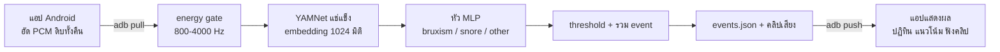

# BruxEcho

ระบบตรวจจับเสียงการนอนกัดฟัน (sleep bruxism) จากไมโครโฟนมือถือ อัดเสียงทั้งคืนด้วยแอป
Android แล้ววิเคราะห์บนคอมพิวเตอร์เพื่อรายงานว่ากัดฟันกี่ครั้ง เมื่อไหร่ และนานเท่าไหร่

โปรเจกต์วิชา AI ระดับปริญญาตรี สาขาวิศวกรรมคอมพิวเตอร์

> ผลลัพธ์ใช้เพื่อการศึกษาเท่านั้น ไม่ใช่เครื่องมือวินิจฉัยทางการแพทย์

## สรุปผลงาน

- ระบบทำงานครบวงจร ตั้งแต่อัดเสียงทั้งคืน ตรวจจับ ไปจนถึงแสดงผลและเล่นคลิปในแอป
- ตัวจำแนกเป็นหัว MLP บน YAMNet เทรนจากชุดข้อมูล DreamCatcher ได้ bruxism AP
  **0.355 ± 0.053** กับคนที่โมเดลไม่เคยเห็น (leave-one-subject-out) สูงกว่า baseline
  0.037 ราว 10 เท่า
- ที่ threshold 0.96 ระดับ event ได้ precision 0.43 และ recall 0.39 นับได้ 506 ครั้ง
  จาก 555 ครั้งจริง จำนวนรวมจึงใกล้ความจริง แต่ยังเจอแต่ละครั้งได้ไม่ครบ
- ทดสอบกับเสียงกัดฟันที่แทรกลงในเสียงนอนจริง เจอ 4 จาก 6 จุด
- **ข้อจำกัดหลักคือ domain shift:** threshold ที่ calibrate จาก DreamCatcher ใช้ข้าม
  อุปกรณ์อัดไม่ได้ กับคืนที่อัดจากแอปทั่วไป เสียงที่คนยืนยัน 3 จุดไม่ผ่าน threshold เลย

## ปัญหาและแนวทาง

การนอนกัดฟันเกิดระหว่างหลับ เจ้าตัวจึงมักไม่รู้ว่าเกิดบ่อยแค่ไหน โปรเจกต์นี้ทดลองวัดจาก
เสียงด้วยมือถือที่ทุกคนมีอยู่แล้ว โจทย์มีความยากสามข้อ:

1. **เสียงถูกตัดทิ้งตั้งแต่ตอนอัด** แอปอัดเสียงทั่วไปบีบอัดเป็น AAC และผ่าน DSP สำหรับ
   เสียงพูด จึงต้องเขียนแอปเองด้วย `AudioRecord` เพื่อให้ได้ PCM ดิบและปิด effect ของเครื่อง
2. **คืนหนึ่งยาวหลายชั่วโมง แต่เหตุการณ์สั้นมาก** จึงใช้ energy gate กรองเสียงส่วนใหญ่ออก
   ก่อนส่งเข้าโมเดล
3. **ข้อมูลกัดฟันมีน้อย** bruxism มีเพียง ~5,000 จาก ~144,000 เฟรม จึงใช้ YAMNet แบบ
   แช่แข็งเป็นตัวสกัดฟีเจอร์ แล้วเทรนเฉพาะหัวจำแนก

## การทำงานของระบบ



- **energy gate** ใช้พลังงานย่าน 800-4000 Hz เทียบกับเกณฑ์ปรับตัว `median + k×MAD`
  ของหน้าต่างเลื่อน 5 นาที และประมวลผลแบบ streaming จึงไม่ต้องโหลดทั้งคืนเข้า RAM
- **YAMNet** รับเสียง 16 kHz ใช้หน้าต่าง 0.96 วินาที ขยับทีละ 0.48 วินาที
- **หัวจำแนก** มีโครงสร้าง 1024→256→64→3 ใช้ class weight เพื่อถ่วงคลาสที่หายาก
- **แอปไม่ได้รันโมเดลบนมือถือ** การวิเคราะห์ทำบนคอมพิวเตอร์ แอปอ่านผลจาก `events.json`
  ที่ส่งกลับไป

## ชุดข้อมูลและวิธีประเมิน

**ข้อมูลเทรน:** ส่วน validation ของ
[DreamCatcher](docs/development-log.md#ชุดข้อมูล--dreamcatcher) (NeurIPS 2024,
CC-BY-4.0) มี annotation ระดับ event จากผู้ถูกทดลอง 4 คน ยุบ label 7 ชนิดเหลือ 3 คลาส
รวม 144,244 เฟรม (train 95,954 / val 48,290) ชุดข้อมูลไม่ได้อยู่ใน repo นี้
และเสียงที่อัดทั้งคืนก็ไม่ได้ถูกอัปโหลด มีเพียงคลิปสั้นตัวอย่างที่ฝังในแอป

**หลักการที่ใช้ประเมิน:**

- **แบ่งข้อมูลตาม session ไม่สุ่มรายคลิป** คลิปจากคืนเดียวกันมีไมค์ ห้อง และคนเดียวกัน
  การสุ่มรายคลิปจะทำให้คะแนนสูงเกินจริง
- **ใช้ leave-one-subject-out (LOSO) เป็นตัวเลขหลัก** เพราะการแบ่งตาม session ยังมีคนชุดเดิม
  ทั้งสองฝั่ง และ LOSO ตอบคำถามว่าใช้กับคนใหม่ได้แค่ไหน
- **เลือก threshold ที่ระดับ event** เพราะ pipeline ต้องการเพียงหนึ่งเฟรมที่ผ่าน threshold
  ตัวเลขระดับเฟรมจึงต่ำกว่าประสิทธิภาพจริงของระบบ
- **ทดสอบด้วยเสียงที่รู้คำตอบ** โดยแทรกคลิปกัดฟันลงในไฟล์เสียงให้ตัวตรวจจับหาเอง
  ไม่เขียนผลลง `events.json` โดยตรง

## ผลการประเมิน

**Leave-one-subject-out** (ค่าเฉลี่ย ± ส่วนเบี่ยงเบนมาตรฐาน จาก 4 fold)

| โมเดล | macro F1 | bruxism AP | ROC-AUC |
|---|---|---|---|
| หัว MLP (ที่ใช้จริง) | 0.522 ± 0.051 | 0.355 ± 0.053 | 0.905 ± 0.054 |
| Logistic regression | 0.516 ± 0.040 | 0.345 ± 0.076 | 0.906 ± 0.052 |
| Majority class | 0.250 ± 0.074 | 0.037 ± 0.025 | 0.500 |

- ผลกับคนใหม่แทบไม่ต่างจากการแบ่งตาม session (AP 0.355 เทียบกับ 0.365)
- หัว MLP ไม่ได้ดีกว่า logistic regression อย่างมีนัย ส่วนที่ทำงานหลักคือ embedding ของ YAMNet
- ที่ threshold 0.96 event recall ตกจาก 0.39 เหลือ 0.24 ± 0.07 ในคนใหม่ เพราะความน่าจะเป็น
  ของคนที่โมเดลไม่เคยเห็นต่ำกว่า

**การเลือก threshold ระดับ event** (แบ่งตาม session, 555 event ใน validation)

| threshold | precision | recall | จำนวนที่แสดง |
|---|---|---|---|
| 0.80 | 0.298 | 0.769 | 1,434 |
| 0.90 | 0.353 | 0.638 | 1,002 |
| **0.96 (ที่ใช้จริง)** | **0.431** | **0.393** | **506** |
| 0.98 | 0.498 | 0.222 | 247 |
| 0.995 | 0.733 | 0.059 | 45 |

เป้าหมายเดิมคือ precision ≥ 0.80 ซึ่งไม่มี threshold ใดทำได้ จึงเลือกจุดที่จำนวนนับใกล้ความจริง
ที่สุด เพราะผลลัพธ์หลักของแอปคือ "กัดฟันกี่ครั้ง" การเลือก 0.995 แม้ precision สูงกว่า
แต่จะนับได้เพียงหนึ่งในสิบของจำนวนจริง

**ทดสอบกับเสียงนอนจริง**

| การทดสอบ | ผล | การตีความ |
|---|---|---|
| แทรกคลิปกัดฟัน 6 จุดที่ SNR 15 dB ในไฟล์ดิบ (`dc_demo_mixed`) | เจอ 4 จาก 6 จุด | บอก recall ได้ แต่บอก precision ไม่ได้ เพราะไฟล์ต้นทางอาจมีเสียงกัดฟันจริงอยู่แล้ว |
| คืนที่อัดจากแอปทั่วไป 7.87 ชั่วโมง (`ext_night01`) | ไม่เจอเสียงที่คนยืนยัน 3 จุด | หนึ่งจุดถูก gate ตัดทิ้ง อีกสองจุดได้คะแนน 0.81 และ 0.67 ต่ำกว่า 0.96 |

## ข้อจำกัด

- **Domain shift:** ไฟล์ที่ผ่าน AAC และ DSP ให้ความน่าจะเป็นต่ำลงทั้งแถบ threshold จึงต้อง
  calibrate ใหม่ด้วยคืนที่อัดจากแอป BruxEcho เอง
- **ผู้ถูกทดลองมีเพียง 4 คน** ค่า AP รายคนอยู่ระหว่าง 0.29-0.43 ผลจึงแกว่งได้มากตามบุคคล
- **ยืนยันผลกับคืนจริงได้น้อย** ground truth ของคืนจริงมาจากการฟังของคน และมีเพียงไม่กี่จุด
- **precision ยังต่ำ** ไม่ควรเชื่อ event รายครั้ง แอปจึงแสดงระดับความมั่นใจและให้ฟังคลิปยืนยันเองได้
- **จำนวนในไฟล์ที่ประกอบขึ้นเพื่อสาธิตเทียบกับคืนจริงไม่ได้** ไฟล์ที่ยืดให้ยาวเต็มคืน
  (`tools/spread_session.py`) มีความเงียบดิจิทัลมาก ทำให้เกณฑ์ของ gate ต่ำกว่าปกติ

ผลลบและบทเรียนอื่น เช่น การจัดอันดับแบบ few-shot ที่แยกเสียงไม่ได้ อยู่ใน
[บันทึกการพัฒนา](docs/development-log.md)

## ติดตั้ง

ต้องใช้ Python 3.11 ขึ้นไป แนะนำ [uv](https://docs.astral.sh/uv/):

```bash
uv sync
```

หรือใช้ venv ธรรมดา:

```bash
python -m venv .venv
.venv\Scripts\activate      # Windows
pip install numpy scipy librosa soundfile matplotlib pandas streamlit tensorflow tensorflow-hub
pip install pytest           # ถ้าต้องการรัน test
```

TensorFlow ใช้พื้นที่ประมาณ 500 MB และไม่ต้องใช้ GPU ส่วนการรันครั้งแรกต้องต่ออินเทอร์เน็ต
เพื่อดาวน์โหลด YAMNet จาก TensorFlow Hub

รัน test ด้วย `pytest` (ใช้สัญญาณสังเคราะห์ ไม่ต้องมีชุดข้อมูล)

## คู่มือการใช้งาน

โมเดลที่เทรนแล้วอยู่ใน `models/bruxism_classifier/` จึงวิเคราะห์เสียงได้ทันทีโดยไม่ต้องเทรนใหม่

**1. อัดเสียงหนึ่งคืน:** ติดตั้งแอปและตั้งค่าตามหัวข้อ [แอป Android](#แอป-android) แล้วเปิดอัดก่อนนอน

**2. ดึงไฟล์ออกจากมือถือ:**

```bash
adb shell ls /storage/emulated/0/Android/data/com.bruxecho.recorder/files/sessions/
adb pull /storage/emulated/0/Android/data/com.bruxecho.recorder/files/sessions/<session_id>/ ./data/raw/sleep/
```

**3. วิเคราะห์และส่งผลกลับเข้าแอป:**

```bash
python -m tools.process_session --session data/raw/sleep/<session_id> --push
```

ได้ `events.json` และ `analysis_clips/` ไว้ข้างไฟล์เสียงเดิม แล้วส่งเข้ามือถือด้วย adb
ถ้าไม่ใส่ `--push` จะวิเคราะห์อย่างเดียว

**4. ดูผลในแอป:** คืนนั้นจะแสดงในปฏิทิน หน้าผลการตรวจจับ และหน้าแนวโน้ม พร้อมคลิปให้กดฟัง

**ถ้าเป็นไฟล์ที่อัดจากแอปอื่น** ให้นำเข้าก่อน แล้วทำต่อที่ขั้นตอน 3:

```bash
python -m tools.import_external --file "path/to/night.wav" --session-id ext_20260820 --dry-run
python -m tools.import_external --file "path/to/night.wav" --session-id ext_20260820
```

ผลจากไฟล์ภายนอกเทียบกับคืนที่อัดจากแอปไม่ได้โดยตรง และควรปรับ `--threshold` ตามข้อจำกัดข้างต้น

เครื่องมืออื่น การเทรนใหม่ และการทดสอบด้วยการแทรกเสียง อยู่ใน [คู่มือเครื่องมือ](docs/tools.md)

## แอป Android

แอปอัดเสียงเป็น PCM ดิบด้วย `AudioRecord` ปิด effect ของเครื่องเท่าที่ปิดได้ และบันทึกค่าที่ใช้จริง
ลง `session.json` เขียนด้วย Kotlin + Jetpack Compose (`minSdk 26`, `targetSdk 35`)

**Build และติดตั้ง:** ต้องมี JDK 17+ และ Android SDK (compileSdk 36) ใช้ JBR ที่มากับ
Android Studio ได้

```bash
cd android
JAVA_HOME="/c/Program Files/Android/Android Studio/jbr" ./gradlew.bat :app:assembleDebug   # build อย่างเดียว
JAVA_HOME="/c/Program Files/Android/Android Studio/jbr" ./gradlew.bat :app:installDebug    # build และติดตั้งลงเครื่องที่ต่อ USB
```

ถ้า clone ใหม่ ต้องสร้าง `android/local.properties` เพื่อระบุตำแหน่ง SDK:

```
sdk.dir=C\:\\Users\\<user>\\AppData\\Local\\Android\\Sdk
```

**ตั้งค่าเครื่อง Samsung ก่อนใช้จริง** ถ้าไม่ตั้งค่า ระบบอาจปิดแอปกลางดึกและเสียข้อมูลทั้งคืน:

1. เปิดแอป → ไอคอนตั้งค่า → **"ขอยกเว้นการประหยัดพลังงาน"**
2. Settings → Battery → Background usage limits → เพิ่ม BruxEcho ใน **"Never sleeping apps"**
3. ในหน้าเดียวกัน ปิด **"Put unused apps to sleep"** สำหรับแอปนี้

ก่อนอัดคืนแรก ให้เข้าหน้า **ตรวจสอบไมโครโฟน** แล้วกด "เริ่มทดสอบ 5 วินาที" เพื่อยืนยันว่า
audio source เป็น `UNPROCESSED` และย่าน 8-16 kHz ยังมีพลังงานอยู่

**สำหรับการนำเสนอ:** เปิด **โหมดสาธิต** ในหน้าตั้งค่าเพื่อใช้ข้อมูลตัวอย่าง 14 คืนได้โดยไม่ต้องอัดจริง
แอปมีป้ายกำกับตลอดเวลาที่เปิดใช้ ส่วนหน้า **ตัวอย่างเสียงอ้างอิง** ใช้ฟังเสียงกัดฟันที่ยืนยันแล้ว
และไม่ถูกนับเป็นผลการตรวจจับ

รายละเอียดเชิงเทคนิคและการออกแบบอยู่ใน [docs/android.md](docs/android.md)

## โครงสร้างโปรเจกต์

```
src/        ไลบรารีหลัก: audio, ฟีเจอร์, energy gate, pipeline, embedding, การเทรน
tools/      เครื่องมือบรรทัดคำสั่งและหน้า Streamlit
tests/      pytest ด้วยสัญญาณสังเคราะห์
models/     ตัวจำแนกที่เทรนแล้ว
configs/    path ของชุดข้อมูลภายนอก
android/    แอปอัดเสียงและแสดงผล
brand/      โลโก้ต้นฉบับ
data/       เสียงดิบ (ไม่อยู่ใน git)
results/    ผลการรัน (ไม่อยู่ใน git)
docs/       เอกสารรายละเอียด
```

## เอกสารเพิ่มเติม

- [คู่มือเครื่องมือ](docs/tools.md): คำสั่งและออปชันของเครื่องมือทุกตัว
- [บันทึกการพัฒนา](docs/development-log.md): เหตุผล ผลทดลอง และปัญหาที่เจอในแต่ละ Sprint
- [โปรโตคอลการอัดเสียงชุดทดลอง](docs/recording-protocol.md): การเก็บคลิป pilot
- [รายละเอียดแอป Android](docs/android.md): หมายเหตุทางเทคนิค โลโก้ และ design system
